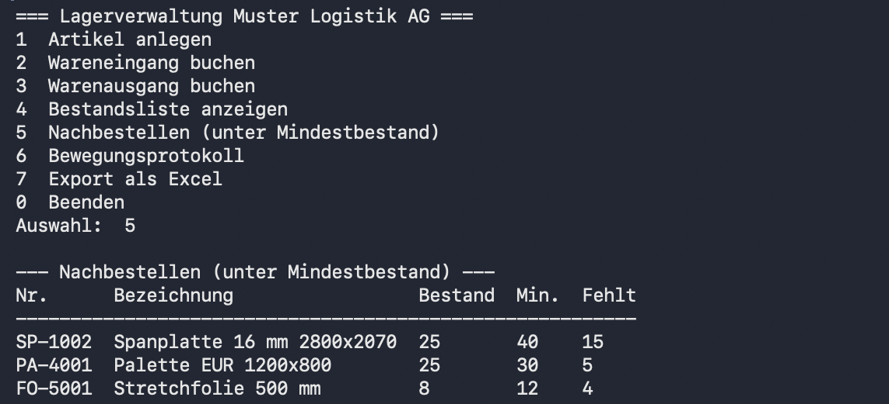

# Lagerverwaltung Muster Logistik AG

Ein Lagerverwaltungs-Programm in Python mit SQLite-Datenbank.

Die Idee kommt aus meiner Lehre als Logistiker EFZ: Im Lager muss man jederzeit wissen, was wo liegt, wie viel davon da ist und wann man nachbestellen muss. Dieses Tool bildet genau diese Abläufe ab.

## So sieht es aus



## Funktionen

- **Artikel anlegen** mit Artikelnummer, Bezeichnung, Lagerplatz (Regal-Fach-Ebene), Bestand und Mindestbestand
- **Wareneingang und Warenausgang buchen**, mit Prüfung, dass der Bestand nie negativ wird
- **Bestandsliste** sortiert nach Lagerplatz
- **Nachbestell-Liste** mit allen Artikeln unter dem Mindestbestand
- **Bewegungsprotokoll**: jede Buchung mit Datum und Uhrzeit
- **Export als Excel**, Artikel unter Mindestbestand werden rot markiert

## Technik

- Python 3
- SQLite (in Python eingebaut) mit zwei Tabellen: `artikel` und `bewegungen`
- openpyxl für den Excel-Export (ohne openpyxl wird automatisch eine CSV-Datei erstellt)

## Aufbau

| Datei | Aufgabe |
|---|---|
| `main.py` | Menü, Eingaben und Ausgabe im Terminal |
| `lager.py` | Lager-Logik (Buchungen, Prüfungen, Abfragen) |
| `datenbank.py` | Verbindung zur Datenbank und Tabellen |
| `export.py` | Excel- und CSV-Export |
| `beispieldaten.py` | Füllt die Datenbank mit Beispielartikeln |
| `test_lager.py` | Automatische Tests |

Logik und Bedienung sind bewusst getrennt. So kann `lager.py` später ohne Änderung auch für eine Weboberfläche verwendet werden.

## Starten

```bash
pip install openpyxl        # optional, für den Excel-Export
python beispieldaten.py     # optional, Beispieldaten laden
python main.py
```

Tests ausführen:

```bash
python -m unittest test_lager.py
```

## Was ich dabei gelernt habe

- Daten in einer SQL-Datenbank speichern und abfragen
- Fehler sauber abfangen (falsche Eingaben, zu wenig Bestand)
- Ein Programm in mehrere Dateien mit klaren Aufgaben aufteilen
- Automatische Tests schreiben

## Nächste Schritte

- Weboberfläche mit Flask
- Inventur-Funktion (Soll- und Ist-Bestand vergleichen)

---

Entwickelt von Wiktor Gorski mit KI-Unterstützung (Claude).
